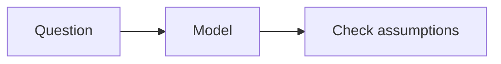

# Edunesia Learning Content

Edunesia content uses a hybrid model. Repository-managed lessons are authored as MDX and compiled by Vite during the application build. This keeps official material reviewable with normal code changes and lets it use registered learning components. Future community content can live in PostgreSQL, but it must pass through a restricted parser and renderer that never evaluates submitted JavaScript or JSX.

## Directory Structure

```text
content/
├── docs/       Architecture notes and content-system documentation
├── guides/     Repository-managed standalone guides
└── courses/    Courses, ordered modules, and lesson MDX
```

The sample courses are `courses/javascript-foundations` and `courses/mathematics-foundations`. Their `course.yaml` files describe each course, each `module.yaml` describes one module, and files under `lessons/` contain lesson frontmatter and teaching content. The mathematics lesson is available at `/learn/sample` and is linked from the landing page. The same course, module, and lesson metadata contracts are exported from `@edunesia/content` as Zod schemas and TypeScript types.

## Content Hierarchy

The hierarchy is **Course → Module → Lesson**. Course and module order is explicit; lesson order is explicit within its module. A lesson records its title, description, slug, difficulty, estimated reading time, objectives, prerequisites, content source, free-form metadata, and content version. IDs for quizzes and exercises refer to application resources; their questions, answers, attempts, grading, discussion, and learner progress do not belong in MDX.

## Authoring a Course

1. Create `content/courses/<course-slug>/course.yaml` using the `courseSchema` fields.
2. Add a module directory with a `module.yaml` file. Use a non-negative `order` to define its position.
3. Add `<order>-<lesson-slug>.mdx` under the module's `lessons/` directory.
4. Include valid lesson frontmatter and use only the approved components below.
5. Keep changes small and review source, metadata, and linked assets together.

Example lesson:

```mdx
---
title: Variables in JavaScript
description: Understand JavaScript variables.
slug: variables
difficulty: beginner
estimatedTime: 10
order: 2
learningObjectives:
  - Declare values using const and let.
prerequisites: []
contentSource: git
version: 1
---

# Variables in JavaScript

Use a named binding to refer to a value.

<Callout type="info">Choose const unless the binding needs reassignment.</Callout>

<CodeBlock language="javascript">const name = "Edunesia";</CodeBlock>

<Quiz id="javascript-variables" />
<Exercise id="javascript-variables-practice" />
```

The web app's `loadOfficialLesson` loader indexes repository lessons with a lazy Vite glob. Vite's MDX plugin compiles these imported `.mdx` modules during the build. YAML frontmatter is recognized, and Git review is the trust boundary for authored components and code examples. `compileTrustedLesson` separately parses frontmatter, validates it against the lesson schema, and checks MDX syntax; it returns source and metadata, not executable code.

## Supported Components

The registry is exported by `@edunesia/content/components`. Components use theme tokens and semantic HTML; application-specific interactive behavior can be connected later through services.

| Component        | Purpose and supported props                                                                                  |
| ---------------- | ------------------------------------------------------------------------------------------------------------ |
| `MathBlock`      | Explicit LaTeX expression; `formula`, optional boolean `displayMode`                                         |
| `CodeBlock`      | Shiki highlighted code; `language`, optional `highlightLines` such as `"2,4-5"`                              |
| `Callout`        | Supporting note; optional `type="info"`, `"warning"`, or `"success"`                                         |
| `Table`          | Responsive table wrapper, also used by Markdown tables                                                       |
| `MermaidDiagram` | Safe diagram source; `chart`, optional accessible `title`                                                    |
| `Image`          | Responsive image; `src`, `alt`, optional `title`                                                             |
| `Video`          | Native controlled video; `src`, `title`, optional `captionsSrc`                                              |
| `Quiz`           | Reference an assessment by `id` only                                                                         |
| `Exercise`       | Reference an exercise by `id` only                                                                           |
| `Tabs`           | Keyboard-operable tabs with `defaultValue`; compose `TabsList`, `TabsTrigger value`, and `TabsContent value` |
| `Note`           | Secondary note                                                                                               |
| `Details`        | Native disclosure element with a required `title`                                                            |

The shared UI package supplies base UI primitives; content components are semantic learning-content wrappers and do not duplicate generic buttons, cards, or inputs.

## Markdown, Math, Code, and Diagrams

`remark-gfm` enables tables, task lists, strikethrough, and autolink literals alongside standard Markdown. Table output scrolls horizontally on narrow screens. Example:

```md
| Method     | Result               |
| ---------- | -------------------- |
| Integral   | Accumulated change   |
| Derivative | Local rate of change |

- [x] Define the variables
- [ ] Check the units
      ~~Superseded assumption~~
      https://edunesia.org
```

`remark-math` recognizes `$...$` inline expressions and `$$...$$` display expressions. `rehype-katex` typesets trusted MDX at build time; the shared `MathBlock` uses the same KaTeX renderer for the validated community AST. KaTeX typesets notation; it does not calculate or simplify expressions. The stylesheet inherits text color from the surrounding shadcn theme, so formulas follow light and dark mode.

```md
Energy is $E = mc^2$.

$$
\int_0^1 x^2\,dx = \frac{1}{3}
$$
```

KaTeX supports fractions, integrals, limits, derivatives, sums, products, matrices, determinants, vectors, Greek letters, common functions, aligned equations, and piecewise functions. The sample at `/learn/sample` demonstrates integrals, a limit definition of a derivative, aligned steps, a matrix and determinant, and a piecewise function.

Fenced code and `<CodeBlock>` use the existing Shiki highlighter from `packages/ui`. Supported languages include TypeScript, JavaScript, Python, C, C++, Rust, Java, SQL, Bash, JSON, HTML, CSS, JSX/TSX, YAML, and Markdown. Shiki loads grammars on demand with paired light/dark themes. Code blocks include line numbers, copy controls, horizontal scrolling, and optional line emphasis:

```mdx
<CodeBlock language="typescript" highlightLines="2">
function derivativeOfSquare(x: number) {
  return 2 * x;
}
</CodeBlock>
```

Mermaid fenced blocks support flowcharts, sequence diagrams, class diagrams, ER diagrams, state diagrams, and Gantt charts. The web renderer loads Mermaid only in the browser, uses `securityLevel: "strict"`, disables HTML labels, limits source size and edges, rejects init directives and click actions, and displays a source disclosure when rendering fails or is unavailable during server rendering.



## Plugin Architecture and Themes

`packages/content/src/plugins.ts` is the shared ordered plugin configuration: `remark-frontmatter`, `remark-gfm`, then `remark-math` at the remark stage; `rehype-katex` runs after Markdown-to-HTML conversion. The Vite plugin compiles trusted Git MDX only. Community content uses the same remark syntax extensions for parsing, validates its AST and component props, then renders a restricted React tree; it never reaches the MDX compiler or JavaScript evaluator. Community KaTeX expressions are typeset with `trust: false`, a length limit, and expansion/size limits. Mermaid is isolated in its own lazy client component and configured with Mermaid's strict security level.

Text, code, math, callouts, tables, tabs, and details use inherited foreground/background and shared UI tokens. Shiki emits light/dark token variables. KaTeX does not set page text colors. Mermaid uses CSS theme tokens for its diagram palette. The sample route includes the existing theme toggle so both modes can be checked.

## Processing Flow

**Authoring → Loading → Parsing → Metadata validation → Content validation → Build-time compilation or restricted rendering → Publishing → Learning experience.**

For repository content, the web app's lazy Vite glob loads `.mdx` modules and the `@mdx-js/rollup` integration compiles trusted MDX during the app build. YAML frontmatter is recognized, and Git review is the trust boundary for authored components and code examples. For community content, `parseCommunityContent` creates an AST, `validateCommunityContent` rejects imports, exports, expressions, raw HTML, unknown components, unsafe URLs, and non-literal or unapproved component attributes, and `renderCommunityTree` creates React elements from the accepted tree. `renderCommunityContent` composes these steps. Community processing does not call MDX `compile`, `evaluate`, or `run`.

## Interactive Learning

MDX contains only references such as `<Quiz id="..." />` and `<Exercise id="..." />`. Application services will load the associated resource, record attempts, grade submissions, and expose learner progress. Comments and discussions attach to lesson or content version IDs outside the document. This keeps instructional prose versionable without embedding user-generated state or answer keys.

## Security Boundaries

- Repository MDX is trusted only after normal source review. It can express MDX, so only maintainers should add or approve it.
- Community documents may use supported Markdown plus registered components with literal allowlisted attributes. JavaScript imports/exports, expressions, spread attributes, raw HTML, arbitrary JSX, and unknown components are rejected.
- Community images and videos accept local single-slash paths and HTTP(S) URLs; `javascript:` and protocol-relative URLs are rejected. A future publishing service should additionally enforce an approved asset host and sanitize/limit remote media.
- Quiz and exercise references contain IDs, never grading logic or trusted answer data.
- The current renderer is a restricted syntax foundation, not a complete publish/moderation service. Validate content again on the server before storing or publishing it.

## Future PostgreSQL Integration

PostgreSQL can store community course/module/lesson metadata, original source text, status, author, and version records. Separate tables/services should own quiz and exercise definitions, attempts, comments, and progress. At publication, validate metadata and the restricted AST before persisting the published version. The content renderer accepts source independently of a storage adapter, so Git files and database rows can share this boundary without trusting database content as executable code. No database schema or CMS is added in this foundation step.

## Contributing Official Content

Add a focused course or lesson under `courses/`, preserve stable slugs, increment `version` when revising published content, and verify objectives, prerequisites, and order. Use the test and typecheck commands documented at the repository root. Do not add raw HTML, imports, exports, or executable expressions to community-facing content. Include assets with the lesson and use descriptive image text.
