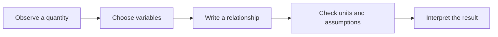

Mathematics gives us a precise language for describing patterns. A model can connect an observable quantity to a compact rule, such as the mass and energy relation $E = mc^2$.

## Accumulated change

If a quantity changes continuously at rate $v(t)$, its total change over an interval is described by an integral:

$$
\int_{0}^{1} 3x^2\,dx = \left[x^3\right]_{0}^{1} = 1
$$

The definite integral adds contributions across the interval. In this example, the area under $3x^2$ from zero to one is one square unit.

<Callout type="info">
  An integral is an accumulation. Its units combine the units of the function with the units of the
  integration variable.
</Callout>

## Limits and derivatives

A derivative measures how a function changes near a point. The limit defines the derivative of $f$ at $x$:

$$
f'(x) = \lim_{h \to 0} \frac{f(x+h)-f(x)}{h}
$$

For $f(x)=x^2$, simplifying the difference quotient gives:

$$
\begin{aligned}
f'(x) &= \lim_{h \to 0} \frac{(x+h)^2-x^2}{h} \\
      &= \lim_{h \to 0} (2x+h) \\
      &= 2x
\end{aligned}
$$

<Note>
  The limit describes behavior as $h$ approaches zero; it does not require substituting zero into
  the original fraction.
</Note>

## Matrices and vectors

A matrix can encode a transformation of a vector. For this two-dimensional matrix, the determinant describes its signed area scale:

$$
A = \begin{bmatrix} 2 & 1 \\ 1 & 3 \end{bmatrix},\qquad
\det(A) = 2\cdot 3 - 1\cdot 1 = 5
$$

The same transformation can be applied to a vector:

$$
A\begin{bmatrix}x\\y\end{bmatrix}
=\begin{bmatrix}2x+y\\x+3y\end{bmatrix}
$$

## A piecewise model

Some rules change depending on the input. A simple absolute-value function is:

$$
g(x) = \begin{cases}
-x & x < 0 \\
x & x \geq 0
\end{cases}
$$

## Follow a process

## Try the computation

<CodeBlock language="typescript" highlightLines="2">
const derivativeAt = 3;
const derivative = 2 * derivativeAt;
console.log(derivative);

</CodeBlock>

The function returns the derivative of $x^2$ at the supplied point. For a square number, the rate of change is twice the input.

<Tabs defaultValue="integral">
  <TabsList>
    <TabsTrigger value="integral">Integral</TabsTrigger>
    <TabsTrigger value="matrix">Matrix</TabsTrigger>
  </TabsList>
  <TabsContent value="integral">
    Integration combines many small contributions into a total change.
  </TabsContent>
  <TabsContent value="matrix">
    Matrix multiplication applies a linear transformation to a vector.
  </TabsContent>
</Tabs>

  KaTeX typesets mathematical notation. It does not evaluate expressions or replace a computer
  algebra system.

<Quiz id="mathematical-models-check" />
<Exercise id="mathematical-models-practice" />
